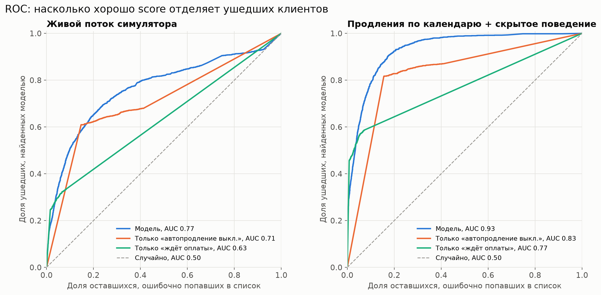
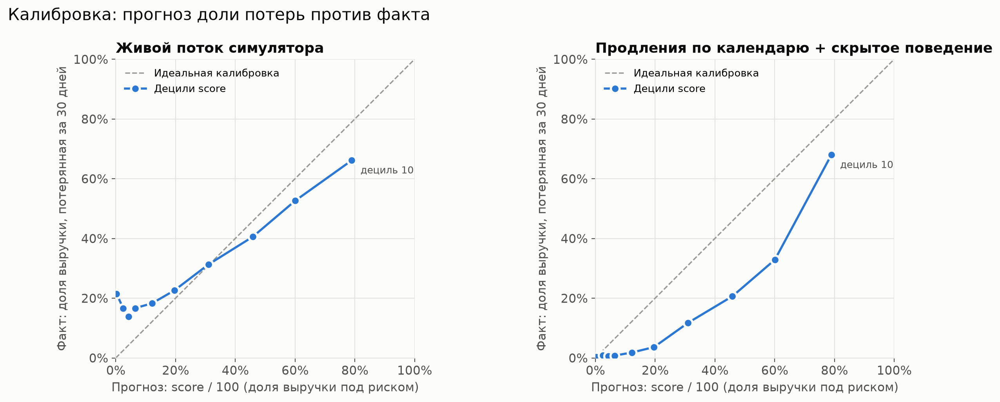
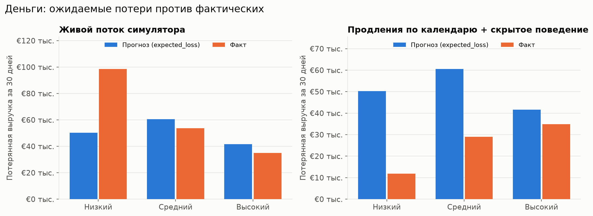

# Проверка качества модели риска

Вопрос простой: если модель на момент T назвала клиента клиентом высокого риска, правда ли он чаще уходит в следующие 30 дней? Настоящих меток ухода в данных кейса нет, поэтому мы проверяем модель на синтетическом будущем: генерируем базу, считаем риск, прокручиваем 30 дней симуляцией и смотрим, кто на самом деле потерял услуги и деньги. Ниже всё, что измерено, и всё, чего такая проверка доказать не может.

Все цифры в этом документе получены командой из раздела «Как воспроизвести» на 20 000 клиентах, seed 42, T = 2026-10-01 12:00 UTC, горизонт 30 дней, веса и пороги модели по умолчанию. Версия кода записана в `tools/calibration/results/results.json`: хеш исходников riskcore `2ddf6ec1cae8`, симулятора `530c4ad01846`, таблицы калибровки `model_tables.json` — `ed7456c1fdc5`. Полные таблицы лежат в `tools/calibration/results/tables.md`.

## Методика

1. **База.** `services/simulator/app/generator.py` создаёт 20 000 клиентов четырёх сегментов (лояльные, рискованные, уходящие, новые). Сегмент в данные не попадает. Мы запоминаем его отдельно, подменяя построитель генератора на время вызова. Набор данных от этого не меняется, и тест это проверяет.
2. **Оценка на T.** `riskcore.score_customers` с настройками по умолчанию. В проверку входят 17 824 клиента с оценкой (уровень low, medium или high) и 37 450 их действующих платных услуг. Клиенты без действующих услуг (уровень unknown) не участвуют.
3. **Будущее на 30 дней.** Два независимых сценария, каждый с шагом в один час.
   - **stream**: живой поток симулятора `stream.World.tick` без изменений. Время идёт по модельным часам, один демо-день равен суткам, поэтому ждущая оплаты услуга удаляется через 5 настоящих дней. Поток в демо не масштабируется под размер базы, поэтому частоту мы задали сами: 1/6 изменения на действующую услугу в сутки. При таком темпе продление (20 % веса в потоке) случается у услуги примерно раз в 30 дней.
   - **calendar**: услуга продлевается точно в день окончания срока. Что сделает клиент (оплатит с баланса, пополнит баланс, продлит вручную, откажется), решает его скрытое поведение: вероятности зависят от сегмента и разбросаны по клиентам распределением Beta. Модель этих вероятностей не видит. Механику списаний, перевода в «Ожидает оплаты» и удаления через 5 дней, а также фоновые изменения (пополнения, переключение автопродления, выключение серверов) мы берём из `stream.World` импортом, без копирования. Своя только привязка продлений к календарю, потому что живой поток выбирает услугу для продления случайно, не глядя на дату окончания.
4. **Исход.** Услуга потеряна, если через 30 дней она в статусе deleted или blocked. Клиент «ушёл полностью», если потеряны все его услуги, действовавшие на T. Потерянная выручка клиента равна сумме выручки за горизонт по потерянным услугам. Выручку услуги берём ту же, что модель отдаёт в поле `horizon_revenue`: выручка в горизонте с ограничением по платёжеспособности клиента (для почасовых услуг она меньше, чем `monthly_price · H / 30`). Поэтому факт и `expected_loss` считаются от одной базы и их можно сравнивать напрямую.
5. **С чем сравниваем.** Простые правила на тех же данных момента T: доля выручки клиента с выключенным автопродлением, доля выручки в статусе «ждёт оплаты» и случайный порядок. Для ориентира показан и «скрытый сегмент»: сегмент генератора, упорядоченный от лояльных к уходящим. Модели он недоступен, это примерная верхняя граница того, что можно вытащить из данных.

## Главный результат


| Уровень | Клиентов | stream: ушли полностью | Lift | calendar: ушли полностью | Lift |
|---|---|---|---|---|---|
| низкий | 12 072 | 7.3 % | 0.44 | 0.8 % | 0.07 |
| средний | 3 659 | 24.6 % | 1.50 | 15.1 % | 1.49 |
| высокий | 2 093 | 54.8 % | 3.34 | 55.8 % | 5.48 |
| все | 17 824 | 16.4 % | 1.00 | 10.2 % | 1.00 |

В обоих сценариях доля ушедших растёт от низкого уровня к высокому, и клиенты высокого риска уходят в 3,3–5,5 раза чаще среднего по базе. Если считать не полный уход, а потерю хотя бы одной услуги, высокий уровень теряет услуги в 72,9 % (stream) и 71,2 % (calendar) случаев против 44,1 % и 19,7 % в среднем по базе.

## Ранжирование



Цель «ушёл полностью». В квадратных скобках 95 % бутстреп-интервал (200 выборок клиентов).

| Метод | stream ROC AUC | stream PR AUC | stream P@5% | stream P@10% | calendar ROC AUC | calendar PR AUC | calendar P@5% | calendar P@10% |
|---|---|---|---|---|---|---|---|---|
| модель | **0.765** [0.754–0.777] | **0.479** [0.459–0.497] | 65.0 % | **57.0 %** | **0.932** [0.927–0.937] | **0.653** [0.631–0.673] | 74.1 % | 59.3 % |
| только «автопродление выключено» | 0.710 | 0.349 | 42.6 % | 45.3 % | 0.831 | 0.333 | 35.2 % | 37.4 % |
| только «ждёт оплаты» | 0.634 | 0.345 | 75.6 % | 51.4 % | 0.772 | 0.521 | 86.3 % | 56.6 % |
| случайно | 0.497 | 0.161 | 15.9 % | 15.7 % | 0.495 | 0.100 | 10.0 % | 9.5 % |
| скрытый сегмент (недоступен модели) | 0.742 | 0.344 | 52.8 % | 51.2 % | 0.916 | 0.507 | 63.8 % | 62.5 % |

По ROC AUC и PR AUC модель лучше всех простых правил в обоих сценариях. По точности в самом верху списка (топ-5 %) её обгоняет правило «ждёт оплаты». Это честный результат: ждущая оплаты услуга без денег почти наверняка будет удалена, а клиентов с такими услугами 12,5 % базы, так что верх списка правило заполняет почти без ошибок. На топ-10 % модель и правило уже почти равны, но правило ничего не говорит про остальные 87,5 % клиентов, у которых ничего не ждёт оплаты. Поэтому его AUC и ниже.

### Проверка там, где ответ не лежит на поверхности

Самый очевидный сигнал, статус «ждёт оплаты», почти совпадает с исходом. Поэтому отдельно смотрим 15 595 клиентов, у которых на T ничего не ждёт оплаты. Цель здесь — потерять хотя бы одну услугу.

| Метод | stream ROC AUC | calendar ROC AUC | calendar PR AUC |
|---|---|---|---|
| модель | 0.616 | 0.843 | 0.368 |
| только «автопродление выключено» | 0.609 | 0.755 | 0.249 |
| только «ждёт оплаты» | 0.500 | 0.500 | 0.106 |
| случайно | 0.494 | 0.504 | 0.106 |

В calendar на этой подвыборке высокий уровень теряет услуги в 44,5 % случаев против 10,6 % в среднем (lift 4,2), а уходит полностью в 35,2 % случаев против 4,8 % (lift 7,3). В stream разница с простым правилом почти пропадает (0,616 против 0,609), причина объяснена в ограничениях.

## Калибровка и деньги



| Дециль score | Score | Прогноз доли потерь | stream: факт | calendar: факт |
|---|---|---|---|---|
| 1 | 0.0–1.0 | 0.3 % | 21.5 % | 0.3 % |
| 3 | 3.8–4.5 | 4.3 % | 13.9 % | 0.5 % |
| 5 | 9.1–15.4 | 12.2 % | 18.3 % | 1.8 % |
| 7 | 24.3–37.9 | 31.0 % | 31.3 % | 11.8 % |
| 9 | 53.9–67.6 | 60.1 % | 52.6 % | 32.9 % |
| 10 | 67.6–92.2 | 79.0 % | 66.1 % | 68.0 % |



| Уровень | Выручка за 30 дн. | expected_loss | stream: факт | Факт/прогноз | calendar: факт | Факт/прогноз |
|---|---|---|---|---|---|---|
| низкий | €509 831 | €50 218 | €98 478 | 1.96 | €11 893 | 0.24 |
| средний | €121 454 | €60 509 | €53 764 | 0.89 | €28 988 | 0.48 |
| высокий | €53 968 | €41 658 | €34 966 | 0.84 | €34 834 | 0.84 |
| все | €685 253 | €152 384 | €187 208 | 1.23 | €75 716 | 0.50 |

Порядок модель держит: в обоих сценариях фактическая доля потерь растёт от дециля к децилю (в stream с провалом в первых трёх децилях). Абсолютные значения откалиброваны плохо, причём в разные стороны. В stream модель недооценивает потери у низкого риска (факт вдвое больше прогноза), в calendar переоценивает потери у низкого и среднего риска (в 2–4 раза) и неплохо попадает у высокого (факт 84 % прогноза в обоих сценариях). Суммарный `expected_loss` €152 тыс. против фактических €187 тыс. и €76 тыс.

Из этого следует, что абсолютная калибровка на синтетике не проверяется. Уровень фактических потерь задаётся параметрами симуляции (темпом потока, вероятностями поведения), а не моделью, и два разумных набора параметров дают ответы, отличающиеся в 2,5 раза. На слайд можно ставить ранжирование и lift по уровням, а `expected_loss` стоит подавать как ориентир для сравнения клиентов между собой, но не как прогноз выручки в евро.

Эти таблицы — про сырой score. Чтобы деньги в панели были ближе к факту, мы добавили калибровку score → вероятность (раздел «Честность модели» ниже): на calendar ожидаемая потеря после неё €77 278 при факте €75 716, на stream — €77 278 при факте €187 208. Та же зависимость от допущений симуляции, только теперь она видна в одном месте и выбор сценария для обучения записан.

## Честность модели

С этой версии `python -m tools.calibration` дополнительно (`tools/calibration/honesty.py`, scikit-learn нужен только здесь):

1. Обучает изотоническую калибровку сырой вероятности услуги в факт «потеряна за 30 дней», логистическую регрессию и градиентный бустинг на силах сигналов признаков. Обучение на сценарии calendar (`--fit-scenario`), метрики вне выборки: клиенты делятся пополам по чётности id.
2. Записывает таблицу калибровки (80 точек), коэффициенты логрега и эталон распределения признаков для монитора дрейфа в `libs/riskcore/riskcore/model_tables.json`. Пишет только запуск с `--out` по умолчанию, чтобы тесты и пробные прогоны не подменяли то, что идёт в рантайм. Файл не входит в хеш исходников (там только `*.py`), его отпечаток лежит в `results.json` (`honesty.tables_sha`), а страница «Качество модели» сверяет его с установленным.
3. Пересчитывает модель с группой «Оплата» и потолками 85, 70, 60, 50.
4. Считает эффект на данных кейса: уровни, ожидаемую потерю, прогноз непродлений и отток до и после.

Главные цифры (полностью — в `tables.md` и в [model.md](model.md#честность-модели)):

| | calendar | stream |
|---|---|---|
| Brier: сырая p → после калибровки | 0.0859 → **0.0624** | **0.1681** → 0.1799 |
| Brier калибровки, обученной на stream | 0.0843 | 0.1578 |
| AUC клиентов: правила / логрег / бустинг | 0.932 / 0.934 / **0.943** | **0.765** / 0.759 / 0.753 |
| Lift топ-10 % клиентов: правила / логрег / бустинг | 5.83 / 6.29 / **6.36** | 3.48 / **3.62** / 3.61 |
| AUC клиентов: без группы / группа «Оплата», потолок 60 | **0.932** / 0.925 | **0.765** / 0.763 |

Калибровка включена по умолчанию: на сценарии, механика которого ближе к биллингу, она уменьшает Brier на 27 %, а на стенде прогноз оказался выше факта, то есть в ту же сторону. На stream она хуже, и это показано на странице. Группы по умолчанию выключены: на синтетике они качество не улучшают. Челленджер остаётся челленджером: выигрыш ML небольшой и только там, где его учили.

## Устойчивость

| Прогон | stream AUC | stream lift high | calendar AUC | calendar lift high |
|---|---|---|---|---|
| seed 42 (основной) | 0.765 | 3.34 | 0.932 | 5.48 |
| seed 43 | 0.775 | 3.36 | 0.935 | 5.50 |
| seed 44 | 0.774 | 3.34 | 0.932 | 5.50 |
| темп потока 1/12 в сутки | 0.814 | 4.11 | — | — |
| темп потока 1/3 в сутки | 0.716 | 2.59 | — | — |
| разброс поведения сильнее (Beta, concentration 2) | — | — | 0.931 | 5.26 |

От seed результат почти не зависит. От темпа живого потока зависит заметно: чем чаще случайные изменения, тем больше потерь, которые нельзя было предсказать на момент T, но AUC остаётся выше 0,71, а lift высокого уровня выше 2,5.

## Ограничения

- **Мир придуман той же командой, что и модель.** Генератор и симулятор писали, зная признаки модели. У уходящего сегмента чаще выключено автопродление и меньше денег на балансе, а в будущем симуляции услуги теряются ровно через эти механизмы: нет автопродления, нет денег, ждёт оплаты. Поэтому высокие AUC подтверждают, что модель правильно читает эти механизмы, но не доказывают, что у реального хостинга клиенты уходят по тем же причинам.
- **Утечка через сегмент в сценарии calendar.** Скрытое поведение задано по сегменту, а сегмент заодно определил признаки на T. Модель сегмента не видит, но признаки с ним коррелируют по построению генератора. Это видно по строке «скрытый сегмент»: его AUC (0,916) почти равен AUC модели (0,932). Почти всё, что модель предсказывает в calendar, она предсказывает, потому что признаки выдают сегмент. Вероятности поведения сегментов (`SEGMENT_BEHAVIOR` в `tools/calibration/future.py`) — наше допущение, ни на чём не откалиброванное.
- **Живой поток не привязан к сроку оплаты.** В stream продление, перевод в «ожидает оплаты» и истечение срока выбирают услугу случайно, не глядя на дату окончания. Из-за этого 17,0 % потерянных услуг в stream имели оплаченный срок дальше горизонта, а в настоящем биллинге такая услуга за 30 дней не удаляется. Отсюда 21,5 % потерь в первом дециле и слабый результат на подвыборке без «ждёт оплаты». Для демо этого достаточно, но как мир для проверки stream скорее пессимистичен к модели. В calendar таких потерь 0 %.
- **Частоту потока задали мы.** 1/6 изменения на услугу в сутки выбрано, чтобы продления шли примерно раз в месяц. От этого числа сильно зависят базовые доли ухода (12–23 % в проверенном диапазоне).
- **Нет обратного влияния.** Модель не меняет поведение клиентов, в симуляции никто не пишет клиентам и не дарит бонусы. В реальности по высокому риску будут работать, и доля ушедших среди них станет меньше.
- **Модель могла поменяться.** riskcore дорабатывается параллельно. Цифры выше относятся к исходникам с хешем `2ddf6ec1cae8`. Пересчёт на этой версии (калибровка, группы признаков, челленджер, монитор дрейфа) дал те же числа ранжирования, что и на прошлой, `40f8d2243edd`, и на позапрошлой, `8d4a86974bd8`: основная проверка идёт по сырому score с группами по умолчанию (выключены), а в симуляторе калибровки визитов нет, и признаки Метрики молчат. После правок модели расчёт нужно перезапустить: тест api `test_results_json_is_fresh` сравнивает хеши в `results.json` с текущим кодом riskcore и симулятора и упадёт, если они разошлись, а страница «Качество модели» покажет предупреждение, если в образе api стоит другая версия riskcore.
- **Синтетика остаётся синтетикой.** Настоящая проверка возможна только на истории реальных статусов (`source.status_history`). Скрипт для этого почти готов: вместо симуляции нужно подставить фактические статусы через 30 дней.

## Как воспроизвести

Из корня репозитория:

```bash
pip install -r tools/calibration/requirements.txt   # numpy, matplotlib, scikit-learn
python -m tools.calibration
```

Команда займёт около трёх минут: основной прогон и пять прогонов на устойчивость (таблица выше). С `--no-robustness` она уложится в минуту, но тогда в `results.json` не будет таблицы устойчивости. Команда запишет `tools/calibration/results/results.json` и `tables.md` и перерисует графики в `docs/img/calibration/`. Основные параметры:

| Параметр | По умолчанию | Смысл |
|---|---|---|
| `--accounts` | 20000 | размер базы |
| `--seed` | 42 | seed генератора и симуляций |
| `--reference` | 2026-10-01T12:00:00Z | момент T |
| `--horizon` | 30 | горизонт, дней |
| `--scenarios` | stream calendar | какие сценарии считать |
| `--stream-rate` | 0.1667 | изменений потока на услугу в сутки (stream) |
| `--background-rate` | 0.02 | фоновых изменений на услугу в сутки (calendar) |
| `--concentration` | 8 | разброс поведения внутри сегмента (calendar), 0 — без разброса |
| `--bootstrap` | 200 | число выборок для доверительных интервалов |
| `--no-robustness` | выключен | не считать прогоны с другими seed и параметрами |
| `--fit-scenario` | calendar | на каком сценарии обучать калибровку и челленджер |
| `--no-honesty` | выключен | не считать калибровку, челленджер и группы |
| `--no-groups` | выключен | не пересчитывать модель с группами признаков |

## В панели

Страница «Качество модели» (`/quality`, открыта всем вошедшим) показывает этот же `results.json`: lift по уровням, ROC-кривые модели и правил, точность и полноту порога «высокий», калибровку по децилям, таблицу бейзлайнов, устойчивость и ограничения. Файл копируется в образ api при сборке (`services/api/Dockerfile`) и отдаётся через `GET /api/v1/model/quality`. Api проверяет его по схеме и убирает то, что панели не нужно (события симуляции, метрики по услугам). Если файла нет или он не проходит проверку, эндпоинт отвечает 503. Чтобы обновить страницу, перезапустите расчёт, закоммитьте `results.json` и пересоберите api.

Для страницы `results.json` дополнительно хранит ROC-кривые на сетке из 101 точки (`scenarios.*.roc`), точность и полноту порогов (`scenarios.*.thresholds`) и прогоны на устойчивость (`robustness`). NaN в файле записывается как `null`.

Тесты:

```bash
python -m pytest tools/calibration/tests
```

Одинаковые параметры дают одинаковые цифры, это тоже проверяется тестом.
